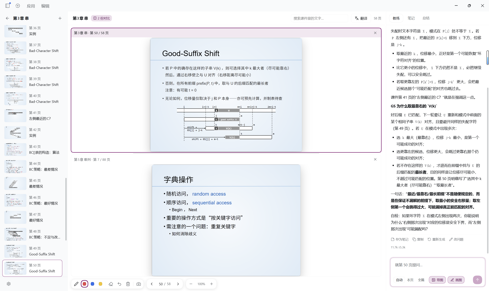
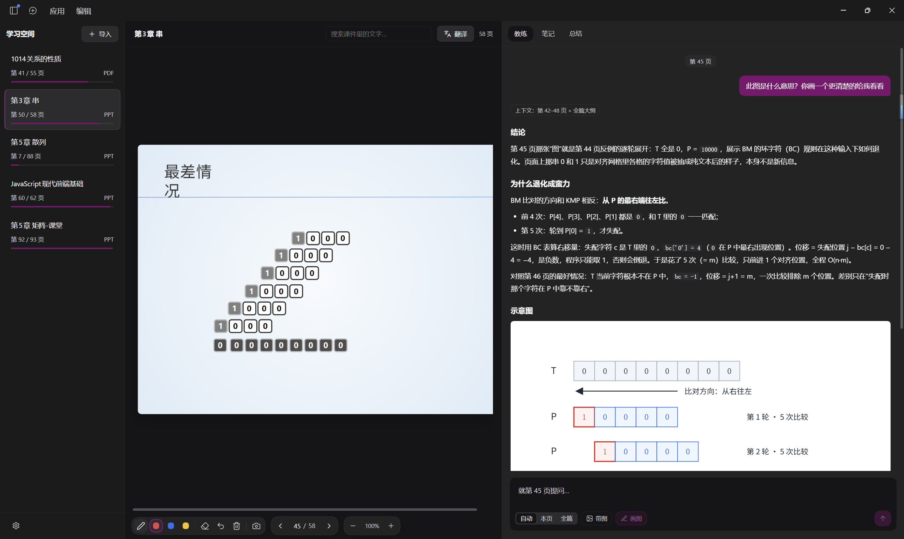
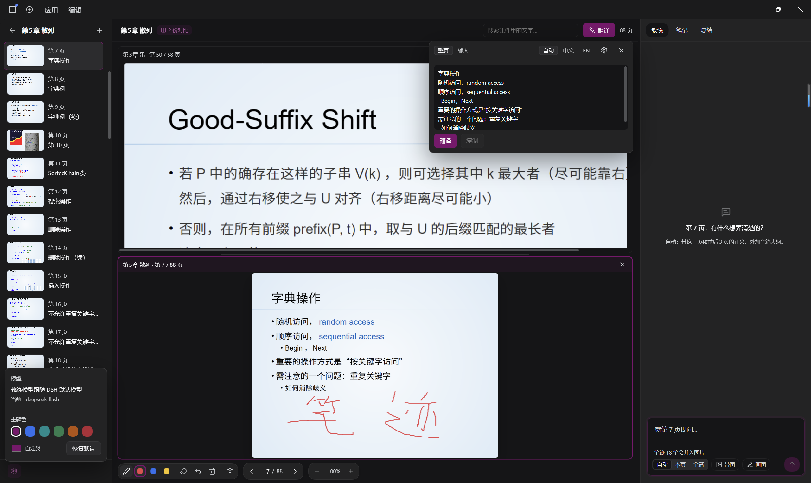

# dsh-learnlab

> A deck-centric study workspace plugin for [DeepSeek Harness](https://www.deepseek.com/en/harness/).

在我们参照PPT等课件学习时，如果遇到问题想问AI，往往需要截图、提供课堂上下文等等来提高AI回答的质量，很容易把我们的手累骨折。

dsh-learnlab 给出了一种解决方案：下次看课件，只需要在 DSH 中打开，便能**自动获取课件大纲、前后页信息或原图、用户在画面上的涂改标记等**丰富上下文，让 LLM 可以**围绕课件内容精确解答问题**。



## dsh-learnlab支持的功能

| 功能 | 描述 |
|---|---|
| **浏览课件** | 用 LibreOffice 引擎把 .ppt(x) / .pdf / .docx 渲染成逐页图片，排版和字体跟原文件一致 |
| **按页提问** | 三档可选：自动、本页和全篇。自动：提问时带上 [当前页-3、当前页+3] 的内容和全篇大纲；本页：当前页和全篇大纲；全篇(**慎选**)：全部页和全篇大纲。这一页的提问也不会混到其他页的上下文中，按页独立 |
| **涂画** | 在页面上直接画，可以 ctrl + z 撤销 |
| **提问原图** | 可选把当前页图片与涂画一起发给模型，这样图表、公式、扫描件模型都能看懂 |
| **提问生图** | 可选让模型回答时可以生成图片辅以解释 |
| **页码锚定的笔记** | 模型回复可存为笔记，存成 Markdown，按页码起标题。对话、笔记、总结分文件保存 |
| **双课件对比** | 支持两份课件上下同屏，各自独立翻页，可用于一些双份文件互相支撑的情况 |
| **整份总结** | 一键生成 `summary.md`，带公式渲染 |
| **翻译** | 支持翻译本页或输入框内容。可用百度翻译 API（没有时自动用MyMemory） |
| **缩放** | ctrl + 鼠标滚轮或底部控件可以缩放画面，范围40%–400%。可按住 Ctrl + 鼠标拖动来移动摄像机 |
| **搜索** | 关键词查找文件内容（需要你已经识别了本页） |



## 安装

在 DSH 侧边栏 **插件** 页的安装框里输入：

```
dsh-learnlab
```

装完默认启用，会在侧边栏多出一个“学习”标签卡。如果没有请 F5 刷新页面或重启 DSH。

## 目录结构

所有内容都落在工作区的 `LearnLab/` 下，纯文本，可以 grep、可以 diff、可以进 Git：

```
LearnLab/
├── 课件库/
│   └── 第3章 串-1a2b3c/
│       ├── notes.md          # 所有笔记
│       ├── summary.md        # 整份总结
│       ├── snapshots/        # 页面截图（带涂画）
│       └── .meta/            # deck.json / pages.json / chat.jsonl / 每页 PNG
├── 课件源文件/               # 课件放这里（如已改路径，以设置为准）
└── .config.json              # 翻译密钥、课件文件夹
```

如果在 learnlab 里删除某课件，只会删 `课件库/` 下的这一份，不会删除源文件。

## 配置

请先进入侧边栏的“学习”标签卡。“学习”界面会将原本的对话区再分为三个栏目，下文说的左栏指的是“学习”页面内部的左栏。

- 左栏左下角齿轮 -> "课件文件夹"，填入任意绝对路径，之后你将课件放进这个路径即可。如果文件夹不存在会自动创建。
**导入课件时，只会在这个文件夹里找课件，只支持 .ppt(x) / .pdf / .docx**。默认 `LearnLab/课件源文件`

- 左栏左下角齿轮 -> "主题色"，可**自定义“学习”插件页主题色**。默认 rgb(126,12,110)

- 左栏左下角齿轮 -> "模型"，可查看当前问答模型配置。**问答模型跟随 DSH 的默认模型**，不能在学习页里更改。改默认模型后，下一条提问立即生效

- 如果要用翻译，记得自己去百度翻译开账号，免费版就够用。不配置也能用免费的 MyMemory，但质量可能不如百度翻译。
使用**百度翻译要设置 appid 和密钥**，在主视图右上角的翻译 -> 设置里填写，会保存到`LearnLab/.config.json`



## 限制与依赖

- **无文字时不会自动识别**，你可以在两个地方进行识别，一是主视图下方的提示条“开始逐页识别”，点击后将会从头到尾识别无文字页，可随时暂停；二是右侧栏问答区输入框处的“识别第 N 页”，点击后仅识别这一页。好处是在文档较大、或者误导入时，你不会因为大量自动进行的识别而破产。

- **Word 文档没有页概念**，只能选择全篇发给模型。在长文档问答中这会花掉你更多的token。

- **扫描件、纯图片 PDF 没有文字层**，需要先对页面做一次识别（点击问答输入框处的"识别第 N 页"），否则只能用带图方式提问。文件打开时不会自动做识别（哦先生，这需要不少token）

- **语言仅有中文**

- **DSH ≥ 0.2.1-rc.2**（此插件用到了 `webServer`、`llm`、`agentDefaultModel`、`attachments` 等服务，以及 `sidebar.panellist` / `main` 槽位）

- **渲染依赖 DSH 随安装包附带的 LibreOffice Kit**。插件会从 DSH 安装目录探测它；如果你的 DSH 没有这个组件，课件页会渲染失败（文字解析仍然可用）

## 再开发

```bash
pnpm install
pnpm build        # 产出 client.js
```

所以 `client.js` 是构建产物，**别改**；改源码去 `src/`。

如果所在环境不允许 esbuild spawn 子进程（已知Windows 沙箱下会报 `EPERM`），就退化成两步，见 [`build/README.md`](build/README.md)。

## 许可证

MIT。第三方组件见 [THIRD-PARTY-NOTICES.md](THIRD-PARTY-NOTICES.md)。
